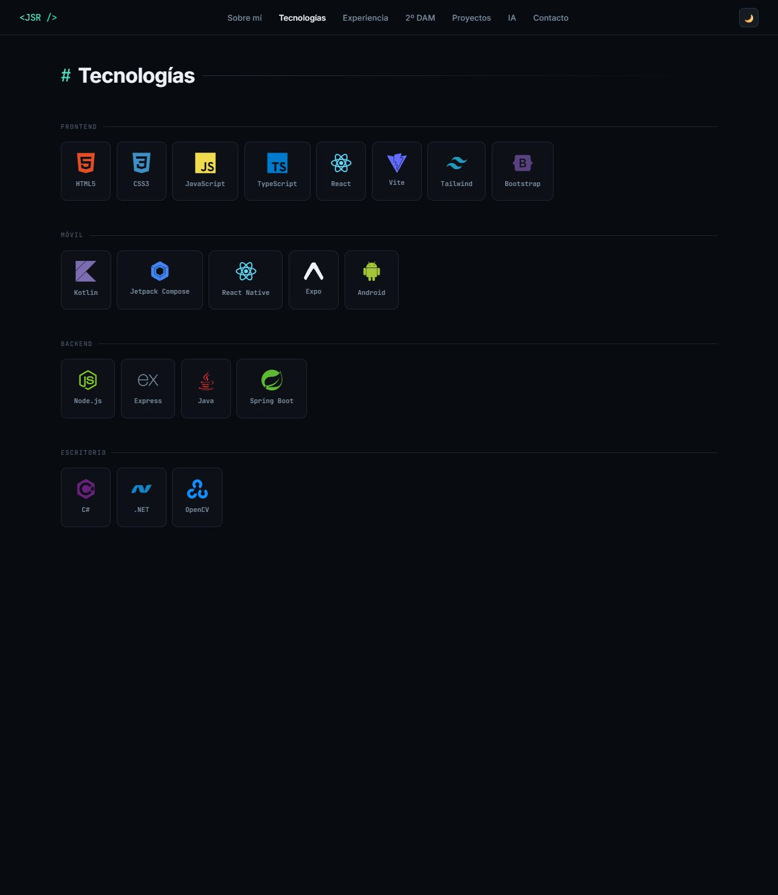
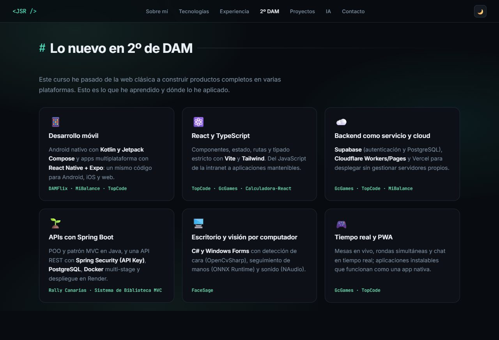
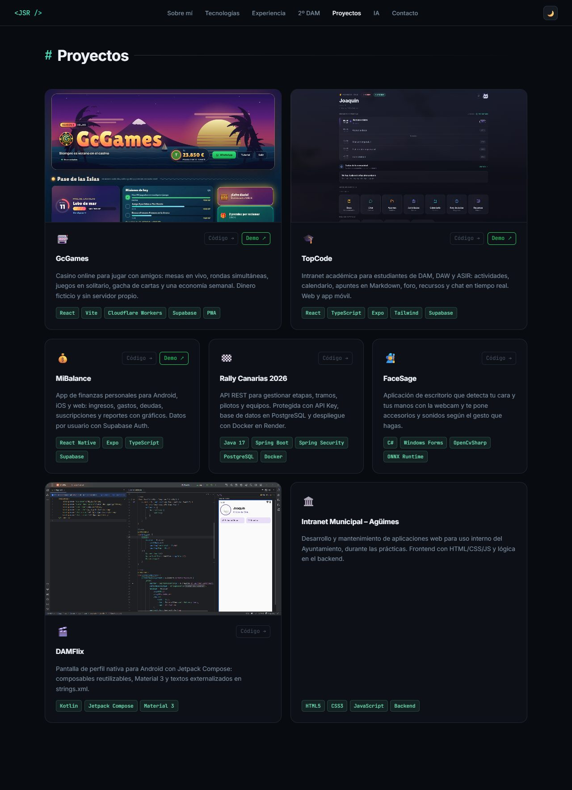

<div align="center">

# Joaquín Suárez Ramírez · Portafolio

**Desarrollador de aplicaciones multiplataforma (2º de DAM) · Las Palmas de Gran Canaria**

Un portafolio que se **construye en vivo mientras haces scroll**: cursores que escriben el texto letra a letra, fotos que se redimensionan como en un editor visual y un hero con olas animadas.

[](https://haise232.github.io/Portafolio/)


</div>

---

## Índice

- [Qué es](#qué-es)
- [Capturas](#capturas)
- [Características](#características)
- [Secciones](#secciones)
- [Cómo funciona el efecto de montaje](#cómo-funciona-el-efecto-de-montaje)
- [Estructura](#estructura)
- [Ejecutar en local](#ejecutar-en-local)
- [Publicar en GitHub Pages](#publicar-en-github-pages)
- [Personalizar](#personalizar)
- [Accesibilidad y rendimiento](#accesibilidad-y-rendimiento)
- [Contacto](#contacto)

## Qué es

Mi portafolio profesional, hecho con **HTML, CSS y JavaScript sin build step ni frameworks**. Reúne mis proyectos de GitHub (web, app móvil, API y escritorio), lo que he aprendido en 2º de DAM y mi experiencia en el Ayuntamiento de Agüimes.

## Capturas

| Tecnologías |
|---|
|  |

| Lo nuevo en 2º de DAM |
|---|
|  |



## Características

- **Montaje en vivo.** Los textos se escriben letra a letra con un cursor por tarea; el cursor agarra la esquina del marco para agrandar el texto y redimensiona las fotos mostrando sus medidas, como en un editor visual. Al terminar se aparta a un lateral.
- **Tema playa:** arena y mar en modo claro, mar de noche en modo oscuro; hero con cielo, sol y olas animadas en CSS/SVG.
- **Tecnologías paso a paso:** primero el contenedor, luego cada recuadro y después su icono.
- **Proyectos reales** con capturas, enlace al código y demo en vivo.
- Barra de progreso y HUD de montaje ligados al scroll, tema verde menta y modo oscuro / claro con persistencia.
- Responsive y con Open Graph para compartir en LinkedIn.

## Secciones

| Sección | Contenido |
|---|---|
| Hero | Presentación, CV y enlaces, con cielo y olas |
| Sobre mí | Resumen y datos de contacto |
| Tecnologías | 32 tecnologías en 6 grupos: Frontend, Móvil, Backend, Escritorio, Datos y Cloud, Herramientas |
| Experiencia | Prácticas en el Ayuntamiento de Agüimes y proyecto personal (API REST) |
| 2º de DAM | Qué he aprendido este curso y dónde lo apliqué |
| Proyectos | GcGames, TopCode, MiBalance, Rally Canarias, FaceSage, DAMFlix |
| Formación y contacto | Estudios y vías de contacto |

## Cómo funciona el efecto de montaje

1. `assets/js/script.js` marca los bloques con `.build-item`; aparecen como un plano (contorno punteado) y se "construyen" al entrar en pantalla.
2. `assets/js/crew.js` crea **un cursor por tarea**. Los elementos con `data-type` se vacían al cargar y el cursor los escribe; los de `data-photo` se revelan y se redimensionan con un marco de selección.
3. Cada texto tiene una copia oculta (`.sr-only`) para que lectores de pantalla, buscadores y rastreadores vean el contenido completo desde el principio.
4. Con `prefers-reduced-motion` todo el efecto se desactiva y la página se muestra completa y estática.

## Estructura

```
├── index.html
├── assets/
│   ├── css/styles.css          # tokens, tema menta y todos los estilos
│   ├── js/
│   │   ├── script.js           # tema, scroll, contadores, montaje de bloques
│   │   └── crew.js             # cursores, escritura y redimensionado
│   ├── img/                    # capturas de proyectos
│   └── cv/                     # CV en PDF
└── docs/capturas/              # imágenes de este README
```

## Ejecutar en local

No necesita servidor ni build. Basta con abrir `index.html` en el navegador:

```bash
git clone https://github.com/Haise232/Portafolio.git
cd Portafolio
# abre index.html
```

Los iconos de tecnologías, las tipografías y Devicon se cargan desde internet.

## Publicar en GitHub Pages

El sitio es estático, sin build:

1. Sube los cambios a la rama `main`.
2. En el repositorio, ve a **Settings → Pages**.
3. En **Build and deployment**, elige **Source: Deploy from a branch**, rama **main** y carpeta **/ (root)**, y guarda.
4. Tras un minuto, el sitio estará en **https://haise232.github.io/Portafolio/**.

Todas las rutas son relativas, así que funciona dentro de `/Portafolio/` sin cambios. El archivo `.nojekyll` evita que GitHub procese el sitio con Jekyll.

## Personalizar

- **Colores:** tokens `--accent` y `--accent-alt` al inicio de `styles.css` (modo oscuro y claro por separado).
- **Velocidad de escritura:** duración en `runType()` de `crew.js` (por defecto 26 ms por carácter, máximo 1,7 s por texto).
- **Proyectos:** tarjetas `.project-card` en `index.html`; las capturas van en `assets/img/proyectos/`.

## Accesibilidad y rendimiento

- Respeta `prefers-reduced-motion` (las olas se detienen).
- Los cursores en reposo se atenúan y se ocultan en pantallas estrechas para no tapar el texto.
- Las animaciones del hero se limitan en dispositivos táctiles.

## Contacto

**Joaquín Suárez Ramírez**
[Joaquinjose1298@gmail.com](mailto:Joaquinjose1298@gmail.com) · [GitHub](https://github.com/Haise232) · [LinkedIn](https://www.linkedin.com/in/joaqu%C3%ADn-su%C3%A1rez-ram%C3%ADrez-145435356/) · Las Palmas de Gran Canaria
